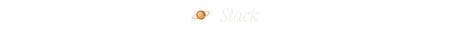

<div align="center">
  
</div>

<br>

<div align="center">
  <picture>
    <source media="(prefers-color-scheme: dark)" srcset="https://raw.githubusercontent.com/poggufanz/poggufanz/main/assets/headings/about-dark.svg" />
    <source media="(prefers-color-scheme: light)" srcset="https://raw.githubusercontent.com/poggufanz/poggufanz/main/assets/headings/about-light.svg" />
    
  </picture>
</div>

```yaml
# ~/about/faiq.yaml
user:          "Muhammad Faiq"
location:      "Indonesia"
class:         "Software Engineer"
guild:         "Computer Science Student"
current_quests: ["Machine Learning", "Web3 Development"]
strategy:      "treat software like chess & gacha — high risk, calculated moves, high reward"
os:            "Arch Linux (btw)"
ide:           "an AI agent"
hobbies:       ["chess", "tetris", "rubik's cube", "games"]
trait:         "jack of all trades"
```

<br>

<div align="center">
  <picture>
    <source media="(prefers-color-scheme: dark)" srcset="https://raw.githubusercontent.com/poggufanz/poggufanz/main/assets/headings/stack-dark.svg" />
    <source media="(prefers-color-scheme: light)" srcset="https://raw.githubusercontent.com/poggufanz/poggufanz/main/assets/headings/stack-light.svg" />
    
  </picture>
  <br><br>
  
</div>

<br>

<div align="center">
  <picture>
    <source media="(prefers-color-scheme: dark)" srcset="https://raw.githubusercontent.com/poggufanz/poggufanz/main/assets/headings/activity-dark.svg" />
    <source media="(prefers-color-scheme: light)" srcset="https://raw.githubusercontent.com/poggufanz/poggufanz/main/assets/headings/activity-light.svg" />
    
  </picture>
  <br><br>
  
  <br><br>
  
</div>

<br>

<div align="center">
  <picture>
    <source media="(prefers-color-scheme: dark)" srcset="https://raw.githubusercontent.com/poggufanz/poggufanz/main/assets/headings/contact-dark.svg" />
    <source media="(prefers-color-scheme: light)" srcset="https://raw.githubusercontent.com/poggufanz/poggufanz/main/assets/headings/contact-light.svg" />
    
  </picture>
  <br><br>
  <a href="https://x.com/mfanxz"></a>
  <a href="https://www.linkedin.com/in/muhammad-faiq-1450832ab/"></a>
  <a href="https://instagram.com/poggufanz"></a>
  <a href="https://facebook.com/mffaiq12/"></a>
  <a href="mailto:mfaiq1205@gmail.com"></a>
</div>

<br>

<div align="center">
  
  <br>
  
</div>
